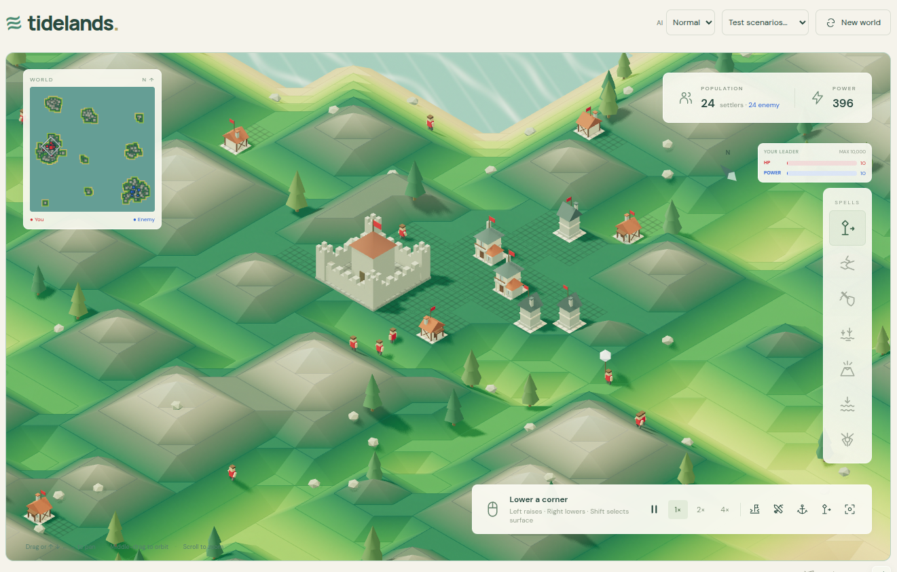
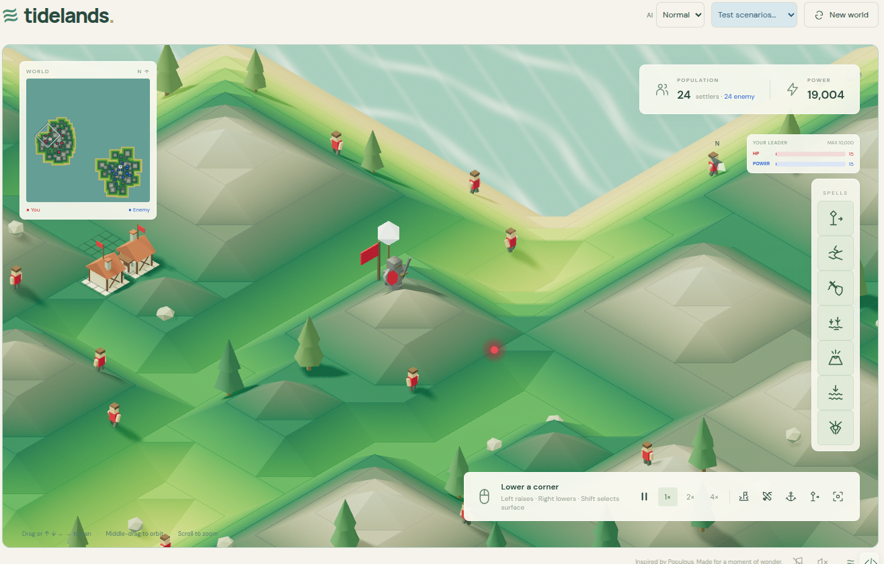

# Tidelands

[play online](https://kazzmir.github.io/tidelands)




A god-game inspired by Populous.

Tech stack: three.js and typescript

## Run locally

```sh
npm install
npm run dev
```

Open the local URL printed by Vite. Requires Node.js 22.12+ (or 20.19+).

```sh
npm test         # Run simulation and architecture tests
npm run build    # Type-check and produce dist/
npm run preview # Serve the production build
```
